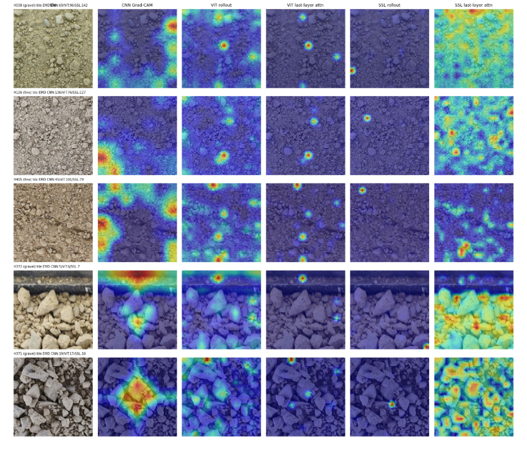

# Soil grain-size prediction from photos: CNNs, ViTs and self-supervised encoders

AI401 Advanced Computer Vision, Assignment #1. Kaggle competition
[Predicting Soil Grain Size Distributions from Images](https://www.kaggle.com/competitions/soil-grain-size-from-photos):
from smartphone photos of a soil sample with a known physical scale, predict the cumulative % passing 11 sieves
(0.002–200 mm).

**TL;DR**

* Pipeline: photo → its own px/mm → resample to **4 px/mm** → hard grid of **56 mm tiles** (224 px), cached once →
  model per tile → mean per photo → mean per sample → valid (monotone, clipped) curve → EMD.
* Validation: **leave-one-sample-out (LOSO) over the 24 physical samples**, the same folds for every experiment.
  All reported CV numbers are the mean ± std of the per-sample EMD across the 24 folds.
* All model families end up in the same band, **36.6–45.5 EMD** (mean-curve baseline 88.3, per-sample std ≈ 30).
  The best single model is frozen ResNet-18 + MLP-EMD head (36.57 ± 27.83). The best ensemble is that model plus
  handcrafted colour/texture features (35.65, chosen by CV).
* The most important finding: **handcrafted colour/texture statistics (38.8), a ViT trained from scratch (37.4) and
  ImageNet / SSL backbones (37–45) are indistinguishable**, and shuffling 32-px patches does not hurt. The signal on
  this data set is global colour/texture statistics of the tile, not learned grain shape.
* **CV and LB disagree strongly** (CV 35.7–39.3 vs public LB 65.2–92.3 for the eight submitted models; the mean-curve
  baseline is 88.3 in CV and 102.4 on the LB). The CV order does not predict the LB order (Spearman −0.12): the two best
  models by CV (ResNet-18 frozen, own ViT from scratch) are the two worst on the LB, and the handcrafted colour/texture
  model is the best (65.16). All models still beat the constant on the test set, by 10–37 EMD instead of 49–53 in CV.
  The test photos come from two iPhones that never appear in train, and the test soils differ from the training soils.
  The final CV-selected ensemble scores 77.51. See [CV vs LB](#cv-vs-leaderboard).

All experiments are in [`notebooks/cv-v3.ipynb`](notebooks/cv-v3.ipynb) (one Kaggle run, T4, 9.2 h). The hypotheses
log is in [`HYPOTHESES.md`](HYPOTHESES.md), every CV score in [`results/cv_results.csv`](results/cv_results.csv),
and the results table with LB scores in [`results/results_table.md`](results/results_table.md).

---

## Repository layout

```
configs/base.yaml              shared settings (tiling, folds, training defaults, augmentation, inference model)
configs/experiments.yaml       every reported experiment and its overrides
notebooks/cv-v3.ipynb          all experiments, Parts 0-7, with outputs
src/soilgrain/                 shared pipeline code extracted from the notebook
    data.py                    photo table: sample id, device, effective px/mm
    metric.py                  EMD, D-value errors, quantile target, monotone projection, soil class
    tiling.py                  physically calibrated tiles (cached once), tile -> photo -> sample aggregation
    folds.py                   LOSO folds, stratified ablation subset
scripts/prepare_data.py        photo table + tile cache + folds.csv
scripts/predict.py             inference: photo(s) + px/mm -> valid grain-size curve
scripts/build_results_table.py CV + LB -> results/results_table.{csv,md}
results/cv_results.csv         CV of all 101 runs (mean ± std, median, per soil class, GPU-h / peak memory where logged)
results/folds.csv              the LOSO folds used by every experiment
results/lb_scores.csv          Public LB of all 10 submitted files
submissions/                   the 5 submission CSVs of 2026-11-01 (final ensemble = sub_best.csv)
HYPOTHESES.md                  hypotheses log (written before each block, results after)
```

### Reproduce

```bash
uv sync                                     # pyproject.toml + uv.lock (Python 3.13, timm 1.0.29)
uv run python scripts/prepare_data.py --data-dir <competition data> --out <work dir>
# experiments: run notebooks/cv-v3.ipynb top to bottom on Kaggle (GPU T4, Internet ON for the pretrained weights)
uv run python scripts/predict.py --photos <photo1.jpg> [<photo2.jpg> ...] --ppm <px/mm> --data-dir <competition data>
uv run python scripts/build_results_table.py --registry <work dir>/experiments/registry.csv
```

Every experiment writes `experiments/<run_id>/` with `config.json`, per-fold Lightning logs, `oof.csv`,
`test_preds.csv`, `per_sample.csv`, `summary.json` (CV, D-errors, per-class EMD, GPU type, GPU-hours, peak memory)
and a submission file. `registry.csv` has one row per run. Seed 42 (+ fold index) everywhere.

---

## Part 0: data, metric, validation, input pipeline

### Data insights

| split | device | photos | samples | stored size | effective px/mm | field of view (mm) |
|---|---|---|---|---|---|---|
| train | Motorola Edge | 69 | 18 / 20 | 720 × 1600 | 4.60 | 348 × 157 |
| train | Samsung A52 | 55 | 22 | 1599 × 1200 | 4.55 | 351 × 264 |
| train | Motorola Edge 60 Fusion | 3 | 1 | 4096 × 2304 | 12.46 | 329 × 185 |
| test | iPhone 14 | 14 | 3 | 4032 × 3024 | 13.94 | 289 × 217 |
| test | iPhone 16 | 21 | 7 | 5712 × 4284 | 19.52 | 293 × 219 |

* 24 labelled samples with 3–8 photos each (127 photos), 10 test samples (35 photos).
* `ppm_updated.csv` gives px/mm per device at **native** resolution. The training photos are stored downscaled and
  without EXIF, so the effective scale is `ppm_native × stored long side / native long side`. The device comes
  from EXIF (test) or the file-name prefix (train).
* **Train and test devices do not overlap.** Train is mostly ~4.6 px/mm, and test is 14–20 px/mm from two iPhones.
  This is the main source of the CV/LB gap.
* Soil classes (fine ≥ 50 % passing 0.063 mm, otherwise sand vs gravel by the larger fraction): 12 gravel,
  7 fine, 5 sand. The curves of fine soils are concentrated on the left half of the grid, and gravels rise only
  above 2 mm.
* Fines (< 0.063 mm) are smaller than one pixel at every available resolution, so the left part of the curve
  can only be inferred indirectly (colour, texture, absence of visible grains).

### Metric

The competition metric is the earth mover's distance between the predicted and true distributions on the
log-diameter grid. For distributions on an ordered 1-D grid, EMD = L1 distance between the cumulative curves,
weighted by the bin widths. With log10 diameters, all bins are ≈ 0.5 decades wide, so
`EMD ≈ 0.5 × Σ|ΔCDF|` over sieves 2…11 (`soilgrain.metric.emd_per_sample`).

**Strengths.** It respects the order of the sieves: predicting the wrong neighbouring sieve costs little, and a
distant one costs a lot. On the log axis it is scale-aware, so a pure scale error of factor *k* costs exactly
`100 · |log10 k|`. It is defined on the CDF the soil engineer actually uses.

**Weaknesses and edge cases.**
* A factor-2 scale error (e.g. a wrong px/mm or a resize) costs **30.1**, a factor 1.5 costs 17.6 and a factor 3
  costs 47.7. That is comparable to the error of our models, so calibration matters as much as modelling.
* The 0.002 mm sieve never enters the metric (it is the left edge of the first bin), and the 200 mm sieve is always
  100 %, so only 10 values matter.
* Every bin has the same weight, so the 0.002–0.063 mm range (invisible in the photos) counts as much as the
  visible 2–63 mm range. Fine soils dominate the error (fine 42–65 vs gravel 27–33 for every model).
* The mean over 24–34 samples is dominated by a few hard samples: the 5 hardest samples contribute 44 % of the
  total EMD.
* It is not sensitive to the *shape* of the curve within a bin and does not reward getting the engineering
  characteristics (D10, D60, uniformity coefficient) right specifically.

**Complementary metric.** `|log10 D_p(pred) − log10 D_p(true)|` for D10, D30, D50, D60 (`d_value_errors`), logged in
every run. 0.301 means a factor-2 error in that characteristic size. These are the quantities used for soil
classification (Cu = D60/D10, Cc = D30²/(D10·D60)).

**Alternative target.** The quantile function `p → log10 D_p` on 39 levels. The 1-D Wasserstein distance on the
log-diameter axis equals the L1 distance between quantile functions, so regressing quantiles is a direct surrogate
of EMD and makes a scale error a constant shift of the target. In practice it gives the same CV as the curve target
(37.8–39.6 vs 37.8–40.8, notebook cell "alternative target") and helps sand (35–41 vs 45–50).

### Validation

* **LOSO over physical samples:** all tiles of all photos of one sample are held out together (24 folds,
  `results/folds.csv`). Photos of one sample are never in train and validation at the same time.
* Tile predictions are averaged per photo, then per sample, before scoring.
* With only 24 groups, LOSO uses the most training data per fold, but every fold is scored on one sample, so the
  CV has a high variance (per-sample std ≈ 30, standard error of the mean ≈ 6). Models are therefore compared with
  **paired** per-sample differences and a bootstrap CI (notebook C10).
* Ablations use a fixed stratified subset of 8 folds (proportional to soil class, spread over D50):
  F827, G190, H037, H183, H366, H368, H516, H666.
* Ridge α is chosen inside each fold by a group-aware inner GroupKFold(4) on the training samples only.

### Input pipeline and tile size

* Every photo is resampled once to **4 px/mm**, which is the finest resolution reachable without upsampling any
  training photo (train ≈ 4.6 px/mm). It is cut into a hard, centred grid of 224-px tiles (**56 mm**) and 384-px
  tiles (96 mm), with no overlap because overlapping tiles are near-duplicates. That gives 2718 tiles at 224 px, of
  which 2193 are train tiles (12–24 per photo). The cache is built in 33 s and reused by every run.
* Because every tile covers the same number of millimetres from every device, a grain looks equally large in
  pixels regardless of the phone. A fixed pixel crop would instead make the model guess the scale.
* **Justification of 56 mm.** It is the largest field of view that still gives ≥ 12 tiles per training photo
  (needed for tile-level training on 23 samples), and it matches the 224-px input of every pretrained backbone
  without resizing. Coarser alternatives were tested with the same heads: 3 px/mm (75 mm) and 2 px/mm (112 mm)
  give 39.3–41.2 vs 39.1–40.8 at 4 px/mm, and 96-mm tiles (384 px) give 41.1 (ConvNeXt-T frozen) and 36.5
  (ResNet-18, 8 folds) vs 41.3 / 34.7. The tile size is not a sensitive parameter, so the finest resolution
  without upsampling is kept.
* Only scale-safe augmentation is used (flips, rot90, mild brightness/contrast/HSV). Random-resized crops and zoom
  change mm/px and therefore the label.

---

## Part 1: CNN approach

Pretrained CNNs on cached features (frozen backbone, MLP-EMD head: softmax over 11 bins → cumsum, bias initialised
to the mean training curve, loss = differentiable EMD), then fine-tuning, then ablations on ResNet-18.

| run | backbone | setup | CV (24 folds) | fine / sand / gravel | GPU-h |
|---|---|---|---|---|---|
| r18_frozen_t224 | ResNet-18 | frozen, AdamW | **36.57 ± 27.83** | 42.1 / 46.6 / 29.2 | 0.04 |
| r18_knn_t224 | ResNet-18 | frozen, weighted kNN | 38.16 ± 29.11 | 47.1 / 46.5 / 29.5 | 0.00 |
| r18_ridge_t224 | ResNet-18 | frozen, ridge | 39.01 ± 26.49 | 49.9 / 47.7 / 29.0 | |
| effb0_frozen_t224 | EfficientNet-B0 | frozen, AdamW | 39.26 ± 30.01 | 51.6 / 47.6 / 28.6 | |
| convnext_t_frozen_t224 | ConvNeXt-T | frozen, AdamW | 41.29 ± 33.78 | 55.3 / 48.7 / 30.0 | |
| convnext_t_frozen_t224_sgd | ConvNeXt-T | frozen, SGD | 39.43 ± 32.14 | | |
| convnext_t_frozen_t384 | ConvNeXt-T | frozen, 96 mm tiles | 41.14 ± 33.34 | | |
| convnextv2b_frozen_t224 | ConvNeXtV2-B | frozen, AdamW | 41.12 ± 31.61 | 56.9 / 44.9 / 30.3 | |
| convnext_t_ft_t224 | ConvNeXt-T | full fine-tuning, frozen BN, 8 ep | 41.71 ± 33.35 | 53.6 / 52.2 / 30.4 | 0.63 |

Ablations on ResNet-18 fine-tuning (8 ablation folds; baseline AdamW, frozen BN, warmup 1 epoch, scale-safe aug):

| variant | CV (8 folds) | Δ vs base | GPU-h | peak GB |
|---|---|---|---|---|
| baseline (AdamW, frozen BN statistics) | 34.74 ± 22.29 | 0.00 | 0.090 | 1.05 |
| BN statistics updated | 34.64 | −0.10 | 0.090 | 1.05 |
| batches from 2 samples only, frozen BN | **32.19** | −2.55 | 0.091 | 1.05 |
| batches from 2 samples only, BN updated | 33.61 | −1.13 | 0.090 | 1.05 |
| BN → GroupNorm(32) | 35.10 | +0.36 | 0.104 | 1.90 |
| SGD + Nesterov (lr 1e-2 / 1e-3) | 33.03 | −1.71 | 0.089 | 1.00 |
| no warmup | 35.35 | +0.61 | 0.089 | 1.05 |
| no augmentation | 34.61 | −0.13 | 0.082 | 1.05 |
| 384-px tiles (96 mm) | 36.49 | +1.75 | 0.079 | 2.62 |

None of the differences is larger than the noise (std ≈ 22 on 8 folds).

**Which inductive biases of CNNs help for soil texture, and which hurt?**
* *Help:* locality and weight sharing (translation equivariance). A soil surface is a stationary texture, so the
  same local filters apply everywhere. Global average pooling turns the feature map into texture statistics, which
  is exactly what the controls show the task needs. This is why even the smallest CNN (ResNet-18, 11 M params) is
  the best single model, and why the CNN recipe is insensitive to optimiser, warmup and augmentation.
* *Hurt:* CNNs are **not scale-equivariant**. A filter responds to a pattern of a fixed size in pixels, so the input
  must have a fixed mm/px (hence physical tiling). The receptive field and the tile are bounded in pixels: a 56-mm
  tile cannot contain a 63-mm cobble, and the upper end of gravel curves is inferred from parts of grains. ImageNet
  features are object-centric and were trained with random-resized crops, which teaches *invariance* to scale,
  the opposite of what this task needs. Bigger CNNs (ConvNeXt-T/V2-B) are not better than ResNet-18.

**What happens to BatchNorm when a batch contains tiles of only a few physical samples?** The batch mean/variance
then describe 1–2 samples instead of the data set. The tiles of one sample are highly correlated, so the
normalisation partly removes exactly the per-sample colour/brightness signal that predicts the label, and the
running statistics drift towards whatever samples were seen last. Train and eval then normalise differently.
Frozen ImageNet BN statistics avoid both problems, and GroupNorm is batch-independent. On our data, two-sample
batches did *not* hurt (32.2 frozen BN / 33.6 updated BN vs 34.7 random batches). Freezing BN statistics was
1.4 EMD better than updating them in that setting, which matches the direction expected, but the effect is within
noise. With 64-tile batches drawn at random from 23 samples (~2–3 tiles per sample), the batch statistics are
close to the data-set statistics, so updating BN costs nothing (34.64 vs 34.74).

---

## Part 2: ViT approach

| run | backbone | setup | CV (24 folds) | fine / sand / gravel | GPU-h |
|---|---|---|---|---|---|
| own_vit_s_scratch_t224 | own ViT-S/16 (Lecture 1) | from scratch, 10 ep | **37.40 ± 29.28** | 45.7 / 36.0 / 33.1 | 0.54 |
| vits_scratch_t224 | timm ViT-S/16 | from scratch, 10 ep | 37.73 ± 32.01 | 47.2 / 37.2 / 32.5 | 0.53 |
| deit_s_ridge_t224 | DeiT-S | frozen, ridge | 38.61 ± 28.26 | 52.0 / 47.4 / 27.2 | 0.02 |
| swin_t_ridge_t224 | Swin-T | frozen, ridge | 38.70 ± 29.45 | 52.1 / 46.8 / 27.5 | 0.04 |
| vits_sup_ft_llrd_t224 | ViT-S AugReg | fine-tuning, LLRD 0.75 | 39.84 ± 33.90 | 49.2 / 51.7 / 29.4 | 0.43 |
| vits_sup_ridge_t224 | ViT-S AugReg | frozen, ridge | 39.87 ± 29.26 | 51.2 / 49.6 / 29.2 | 0.03 |
| maxvit_t_knn_t224 | MaxViT-T | frozen, kNN | 40.19 ± 30.00 | | |
| vits_sup_frozen_cls | ViT-S AugReg | frozen, MLP head, CLS | 40.52 ± 31.97 | 51.4 / 47.3 / 31.4 | 0.05 |
| vits_sup_ridge_t384 | ViT-S AugReg | frozen, 96 mm, pos-embed interpolated | 41.19 ± 29.78 | | |

`OwnViT` (patch embedding, CLS, learned absolute position embedding, pre-norm blocks with SDPA, drop-path) uses
timm's parameter names and reproduces timm's ViT-S/16 exactly when given the same weights (checked in the notebook).

ViT fine-tuning ablations (8 ablation folds; baseline = AdamW, LLRD 0.75, drop-path 0.1, WD 0.05 not applied to
biases / norms / pos_embed / cls_token, warmup 1 epoch, scale-safe aug):

| variant | CV (8 folds) | Δ vs base | GPU-h | peak GB |
|---|---|---|---|---|
| baseline ViT-S/16 | 36.78 ± 27.87 | 0.00 | 0.433 | 2.63 |
| no layer-wise LR decay | 41.00 | **+4.23** | 0.147 | 2.63 |
| no stochastic depth | 41.01 | **+4.23** | 0.145 | 2.63 |
| no augmentation | 39.90 | +3.12 | 0.146 | 2.63 |
| CNN-style weight decay 1e-4 | 38.35 | +1.58 | 0.148 | 2.63 |
| no warmup | 35.69 | −1.09 | 0.148 | 2.63 |
| patch 32 (ViT-S/32) | 36.83 | +0.06 | 0.091 | 1.05 |
| DeiT-S | 38.75 | +1.97 | 0.148 | 2.63 |
| Swin-T (no LLRD) | 36.80 | +0.03 | 0.261 | 5.07 |

**Prediction before running** ([H4](HYPOTHESES.md#h4-vit-from-scratch-before-c13)): the from-scratch ViT would sit
at the mean-curve level (80–88) and far below any pretrained ViT and the pretrained CNN. **It was wrong:** the
from-scratch ViTs (37.4 / 37.7) are as good as the best pretrained models. On this data set, the signal is global
colour/texture statistics (Part 4), which a randomly initialised ViT with a mean-curve-initialised head, EMD loss,
WD 0.05 and drop-path can fit in 10 epochs. What pretraining normally provides, spatial structure and object
parts, is not needed here.

**Why does pretraining usually matter more for ViTs than for CNNs?** A ViT has almost no built-in prior. Locality,
translation equivariance and the 2-D neighbourhood structure must all be learned from data through attention and
position embeddings, while a CNN gets them from its architecture. With little data, a ViT from scratch therefore
over-fits or learns poorly, and pretraining supplies those priors as weights. Our result is the exception that
confirms the reason: when the task needs only first-order texture statistics, missing spatial priors cost nothing.

**CNN vs ViT optimisation recipes.** The CNN is insensitive to the optimiser (SGD ≈ AdamW), warmup, augmentation and
normalisation (all within ±2.6). The pretrained ViT needs its recipe: removing LLRD or stochastic depth costs about
+4.2, removing augmentation +3.1, and CNN-style weight decay +1.6. Explanation: a ViT's loss landscape is sharper and
its early layers (patch embedding, position embedding) are fragile. Without LLRD, the same LR that adapts the top
blocks destroys the low-level pretrained features, and without regularisation the 21.7 M parameters over-fit 23
samples. AdamW's per-parameter scaling is needed because the gradient scales differ by orders of magnitude between
LayerNorm, attention and MLP weights. The CNN's convolutional prior and BN keep its landscape smooth enough for
plain SGD + momentum. Warmup did not help here (−1.1), probably because the head starts at the mean curve and the
backbone LR is already small (1e-4 with LLRD down to 2.4e-6 at the patch embedding).

---

## Part 3: tuning self-supervised models

Encoders: DINOv2-S/14 and DINOv2-B/14 (`lvd142m`), DINOv3-S/16 (`lvd1689m`), MAE-B/16. All frozen variants use
CLS + mean patch token ("avgcat") unless stated, and 4 dihedral views averaged (TTA).

Frozen features, 24 folds:

| encoder | MLP-EMD head | ridge | weighted kNN (k=20, τ=0.1) |
|---|---|---|---|
| MAE-B | 39.45 | **37.81 ± 27.05** | 40.70 |
| DINOv2-S | 42.66 (CLS 42.54) | 42.15 | 40.08 |
| DINOv3-S | 42.94 | 42.31 | 40.68 |
| DINOv2-B | 45.54 | 44.03 | 41.36 |

Tuning strategies on the 8 ablation folds (frozen → LP → LP-FT → FT → LoRA; LoRA r = 8, α = 16 on qkv + proj of every
block = 221,184 trainable backbone params, 1.02 % of the backbone):

| encoder | frozen MLP | frozen ridge | frozen kNN | LP-FT | full FT (LLRD) | LoRA |
|---|---|---|---|---|---|---|
| DINOv2-S | 41.67 | 38.43 | 41.32 | 41.71 | 37.77 | **37.56** |
| DINOv3-S | 43.86 | 39.32 | | | 41.21 | 39.75 |
| MAE-B | 39.37 | **35.20** | 41.34 | | 35.85 | |
| ViT-S sup. (ref.) | 37.55 | 38.02 | | 40.30 | 36.78 | 37.01 |

GPU cost on the 8 folds: frozen ridge/kNN ≤ 0.05 h, LoRA 0.14–0.19 h (peak 1.8–2.3 GB), FT 0.20–0.58 h (2.6–5.9 GB).

**Domain adaptation.** Continued DINO pre-training of DINOv2-S on the 546 unlabelled 96-mm **train** tiles (60 epochs,
2 global 224-px + 4 local 98-px crops, EMA 0.996, 2048 prototypes, T4 ≈ 9–10 GPU-min per run). Three variants:
scale-safe multi-crop (plain crops, mm/px preserved), standard resize multi-crop, and scale-safe + a cosine anchor to
the original encoder with a teacher-temperature warm-up.

| encoder | ridge (24) | kNN (24) | FT (8) | LoRA (8) | test/train NN-dist ratio | teacher entropy at end |
|---|---|---|---|---|---|---|
| DINOv2-S original | 42.15 | 40.08 | 37.77 | 37.56 | 3.28 | |
| + DINO scale-safe | 41.76 | 40.76 | 37.93 | **37.42** | 5.24 | 2.65 (partial collapse) |
| + DINO resize | 43.57 | 42.73 | | | 5.23 | 2.38 (partial collapse) |
| + DINO scale-safe + anchor | 41.95 | 40.83 | 41.24 | 40.53 | 5.73 | 6.52 (no collapse) |

Training curves (DINO loss, teacher entropy, effective number of prototypes, anchor loss) are saved by the notebook as
`da_training_curves.png` and `<tag>_history.csv`. **Did it help?** No. Scale-safe adaptation changes CV by −0.4 to
+0.7 (noise) at 9 GPU-min, and the resize variant is about 2 EMD worse than scale-safe. The unanchored runs partially
collapse (effective prototypes 1541 → 55–73), and all variants move the encoder *towards the training devices*: the
test/train nearest-neighbour ratio grows from 3.3 to 5.2–5.7. Adapting on train tiles only cannot close a shift
caused by unseen test devices. Test photos were **not** used for SSL.

**Which augmentations are label-destroying for this task, and why?** Every augmentation that changes mm per pixel:
random-resized crop, zoom, scale jitter, and resized local crops in multi-crop. A crop of 40 % of the area resized to
224 px makes every grain look ×1.6 larger, which is a different soil (a ×2 scale error alone costs 30 EMD). Strong
blur is also label-destroying, because blur makes coarse soil look fine (see the scale-robustness test). Strong
colour jitter / grayscale removes colour, which carries ~3 EMD of signal (grayscale control). Scale-safe multi-crop
takes local crops as smaller windows at the same mm/px, with flips, rot90 and mild brightness only.

**Can fine-tuning be worse than frozen features here, and why?** Yes. LP-FT DINOv2-S 41.71 vs ridge 38.43,
DINOv3-S FT 41.21 vs ridge 39.32, ConvNeXt-T FT 41.71 vs ridge 39.26 (24 folds), and MAE-B FT 35.85 vs ridge 35.20.
CKA between the encoder before and after fine-tuning (layer-wise linear CKA on 512 tiles) shows why:

| model | tiles | block1 | block4 | block6 | block9 | block12 | final |
|---|---|---|---|---|---|---|---|
| ViT-S FT | train | 1.000 | 0.999 | 0.991 | 0.887 | 0.739 | **0.578** |
| ViT-S FT | test | 1.000 | 1.000 | 0.999 | 0.975 | 0.937 | **0.913** |
| DINOv2-S FT | train | 0.975 | 0.947 | 0.861 | 0.756 | 0.683 | **0.593** |
| DINOv2-S FT | test | 0.942 | 0.958 | 0.943 | 0.853 | 0.815 | **0.798** |

Fine-tuning rewrites the upper layers strongly on training-domain tiles (CKA 0.58–0.59), but it barely moves the
representation of test-domain tiles (0.80–0.91). This is feature distortion: the head is fitted to distorted
train features, while test features stay close to the pretrained ones, so head and features no longer match outside
the training distribution. With 23 samples, FT also over-fits. Frozen features + ridge keep the
representation unchanged and only fit a strongly regularised linear map. LP-FT should reduce the distortion (the head
starts near optimal, so early gradients into the backbone are small), but here the 40-epoch LP head over-fitted the
tile features first, and LP-FT ended up worse than plain FT.

MAE is the clearest example of frozen vs fine-tuned rankings agreeing here (MAE is best frozen *and* best fine-tuned),
which contradicts the usual MAE story (weak linear probe, strong FT). The pixel-reconstruction objective keeps exactly
the colour/texture statistics that this task needs.

---

## Part 4: interpretation

Grad-CAM (ConvNeXt-T FT, last conv stage, gradient of the mean predicted % passing), attention rollout and last-layer
CLS attention (ViT-S FT and DINOv2-S FT) on the same median-contrast tile of 5 samples: the 3 hardest and the 2
easiest samples of the first frozen CNN run, chosen from OOF errors and not by hand. The maps are saved as
`interpretation_maps.png`. On the hard samples (H038 gravel, H126 and H405 fine), the tile-level EMD is 45–142 for all
three approaches, and on the easy gravels (H371, H372) it is 5–19.


What the maps show:
* **CNN Grad-CAM** gives 2–4 broad blobs per tile. On the hard tiles they sit at the tile edges and corners
  (H038 top-right, H126 bottom-left, H405 left edge), not on particular grains. On the easy gravels they cover a
  large stone (H371) and, on H372, also the dark container rim at the top of the tile, i.e. background.
* **ViT rollout** is scattered over the whole tile in small spots; **ViT last-layer CLS attention** is concentrated
  on 3–6 single tokens that do not line up with grain boundaries.
* **SSL (DINOv2) rollout** collapses onto one or two single tokens on every tile, so it says almost nothing.
  **SSL last-layer attention** is the opposite: spread over the whole tile, following the stone bodies and edges on
  the gravel tiles and a fine speckle on the fine/sand tiles.
* **Failures vs successes.** The hard tiles (H038, H126, H405) are uniform fine/mixed texture without large
  objects, and all maps there are diffuse or sit at the tile border. On the easy gravels the CNN and the SSL maps
  land on the large stones. None of the three approaches shows a localised, grain-by-grain decision; together with
  the controls below this points to a decision made from global colour/texture of the tile. One caveat: Grad-CAM
  on H372 reacts to the container rim, so non-soil background inside a tile can influence the prediction.

**Shortcut control experiments** (ridge on frozen ViT-S features of perturbed tiles, same LOSO folds, plus
non-image controls):

| control | CV | fine | sand | gravel | conclusion |
|---|---|---|---|---|---|
| original tiles | 39.87 | 51.2 | 49.6 | 29.2 | |
| shuffled 32-px patches (layout destroyed) | 39.73 | 51.3 | 49.4 | 28.9 | spatial layout > 8 mm is not used |
| blur r = 2 px | 42.12 | 58.0 | 50.2 | 29.5 | fine detail matters for fine soils |
| grayscale | 42.78 | 54.6 | 54.5 | 31.0 | colour carries ~3 EMD |
| shuffled pixels (colour histogram only) | 43.41 | 62.1 | 46.2 | 31.4 | the colour histogram alone gives most of the signal |
| handcrafted colour/texture features (22 per tile) | **38.82** | 47.0 | 46.3 | 31.0 | as good as deep features |
| metadata only (scale, device, tile position) | 86.69 | 105.2 | 76.0 | 80.3 | = mean curve: **no scale/device shortcut** |

**Conclusion.** The models do not exploit background, rulers, device or the px/mm value (metadata alone is at the
mean-curve level). They also do not need the spatial arrangement of grains (patch shuffle changes nothing). They look
at global colour and texture statistics of the soil surface, which handcrafted features capture just as well. This is
a legitimate signal, since soil colour and roughness correlate with grading, rather than a dataset artefact, but it
limits how far any model can get on 24 samples, and it explains why every family converges to the same band.

---

## Part 5: conclusions on optimisation

**CNN.** *Worked:* frozen pretrained features with a small head (best single model), discriminative LR when
fine-tuning, frozen BN statistics, scale-safe augmentation, TTA over dihedral views. *Did not matter:* SGD vs AdamW,
warmup, augmentation, GroupNorm, batch composition. *Did not work:* bigger backbones (ConvNeXt-T/V2-B ≥ ResNet-18),
96-mm tiles, full fine-tuning of ConvNeXt-T (41.7 vs 39.3 frozen + ridge). Reason: the signal is low-dimensional
texture statistics, so capacity and fine-tuning add variance, not information.

**ViT.** *Worked:* the DeiT/AugReg recipe (AdamW, LLRD 0.75, drop-path 0.1, WD 0.05 excluding biases/norms/pos_embed/
cls_token, augmentation); removing LLRD or drop-path costs about 4 EMD. Training from scratch worked surprisingly
well (37.4). *Did not matter:* warmup, patch size 16 vs 32, CLS vs CLS + mean pooling, Swin vs ViT. *Did not work:*
higher input resolution with interpolated position embeddings (41.2 vs 39.9).

**SSL.** *Worked:* frozen MAE features + ridge (best SSL), LoRA as the cheapest tuning that matches FT (0.3 M trainable
parameters, 60 % of the FT memory). *Did not work:* DINO features (worst frozen features), LP-FT, DINOv2-B (worse than
-S), continued DINO adaptation (no gain, partial collapse, larger train/test gap).

**Hypotheses that turned out wrong** (details in [HYPOTHESES.md](HYPOTHESES.md)):
* **H1:** we expected DINO frozen features to be the best and MAE the worst. It was the reverse, because DINO's
  colour/blur invariance removes the cues that predict fines.
* **H2 (partly):** we expected kNN to be worse on fine/sand. It was better for DINO backbones, because the convex
  combination of training curves acts as shrinkage.
* **H4:** we expected a ViT from scratch to fail (CV 80–88). It matched the best models, because the task needs only
  global statistics.
* **H5:** we expected the train/test shift to be colour. Colour normalisation did not reduce it and hurt CV; the
  shift is in the acquisition (devices, resolution, sharpness).
* **H7:** we expected scale-safe DINO adaptation to help. It did not, and it increased the train/test distance; only
  the "resize is worse than scale-safe" part held.
* *Post-hoc (Part 1):* we expected two-sample batches to hurt BatchNorm. They did not.

---

## Part 6: comparison of approaches

Best fine-tuned model per family (24 folds), with cost and robustness:

| approach | run | CV | fine | sand | gravel | GPU-h | peak GB | params M | inference img/s (T4, bs 64) | Δlog10 D50 at ×2 px/mm error | EMD with 25 % / 100 % of samples |
|---|---|---|---|---|---|---|---|---|---|---|---|
| CNN | convnext_t_ft_t224 | 41.71 ± 33.35 | 53.6 | 52.2 | 30.4 | 0.63 | 4.57 | 27.8 | 681 | −0.208 | 48.2 / 40.6 |
| ViT | vits_sup_ft_llrd_t224 | 39.84 ± 33.90 | 49.2 | 51.7 | 29.4 | 0.43 | 2.63 | 21.7 | 1191 | −0.158 | 50.1 / 39.5 |
| SSL | dinov2s_ft_llrd_t224 | 39.30 ± 35.52 | 50.1 | 42.3 | 31.7 | 0.58 | 3.58 | 21.6 | 851 | −0.225 | 48.9 / 40.3 |

Best by CV regardless of tuning: CNN r18_frozen_t224 36.57, ViT deit_s_ridge_t224 38.61 (own ViT from scratch 37.40),
SSL maeb_ridge_t224 37.81. The data-efficiency column uses ridge heads on frozen features with 25 / 50 / 100 % of
the training samples per fold (3 repeats): every family loses 8–11 EMD at 25 %, and the SSL encoder (MAE) is the most
data-efficient (47.5 at 25 %).

**Robustness to scale** (`scale_robustness.png`, same 5 samples, best fine-tuned model per family).
* *Calibrated rescaling* (the photo is resized and px/mm corrected, so the pipeline resamples back to 4 px/mm):
  an ideal model gives the same curve. Ours do not. Downscaling a photo to 0.35× before resampling shifts the
  predicted log10 D50 by −0.2 (finer) for every family. The lost detail and the blur after upsampling are read as
  "fine soil".
* *Mis-calibrated px/mm* (photo unchanged, wrong scale given): if the assumed px/mm is ×2 too high, grains look
  ×2 smaller, and the ideal response is Δlog10 D50 = −0.301. The models respond with −0.16 (ViT), −0.21 (CNN) and
  −0.23 (SSL), so they follow the scale only 50–75 % of the way. When the px/mm is ×2 too low, the image is
  *up*sampled and the ideal response is +0.301. The ViT and SSL models respond only with +0.06 / +0.11, and the
  CNN moves in the wrong direction (−0.07), because upsampling blurs the image and blur reads as "fine".
  The SSL model is the most scale-sensitive and the ViT the least.

**Where does each approach fail?** All three fail on the same samples (pairwise OOF error correlation 0.86–0.98):
fine soils (EMD 50–54) and sand (45–47), vs gravel 32. By device, Samsung A52 photos are the hardest (44–46) and
Motorola Edge photos are easier (38–39). The single Motorola Edge 60 Fusion sample (12.5 px/mm) is a gravel and easy
for the CNN (16.9) but not for SSL (32.5). The hardest samples are the same for every model: H038 (gravel, mean EMD
118), H126 and H405 (fine, 83), H616 (sand, 74).

---

## Part 7: ensemble

* OOF errors are highly correlated: the mean pairwise correlation over all 24-fold runs is **0.94**. Among the
  per-family bests: ResNet-18 vs MAE ridge 0.95, MAE vs DeiT 0.98, and ResNet-18 vs handcrafted only 0.86.
* Selection: start from the best single model, then greedily add the least-correlated model whose CV is within
  +4 EMD of the best (diverse greedy), versus top-k by CV.

| strategy | members | CV | std | mean error corr. |
|---|---|---|---|---|
| best single | r18_frozen_t224 | 36.57 | 27.25 | |
| top-2 by CV | + own_vit_s_scratch_t224 | 35.82 | 27.79 | 0.909 |
| top-4 by CV | + vits_scratch + maeb_ridge | 35.66 | 28.20 | 0.909 |
| **diverse greedy (2)** | **r18_frozen_t224 + handcrafted_ridge_t224** | **35.65** | **25.18** | **0.863** |
| diverse greedy (3) | + alt quantile | 35.88 | 25.26 | 0.854 |
| CNN + ViT + SSL family bests | r18 + deit_s ridge + maeb ridge | 36.69 | 27.46 | |

The ensemble gains **0.92 EMD** over the best single model (bootstrap 95 % CI −1.26 … +3.20, wins on 11 of 24
samples), so the gain is not significant. With error correlations of 0.86–0.98, averaging cannot cancel much error.
The diverse pair is as good as top-4 with half the members and a lower std, because the handcrafted model makes
*different* errors (lower correlation) even though it is not among the best by CV. **Final submission**
(`submission.csv`) = diverse greedy (2), chosen by CV and not by the public LB.

---

## CV vs leaderboard

| submission | CV (24 folds) | Public LB | improvement over mean curve: CV / LB |
|---|---|---|---|
| handcrafted_ridge_t224 (22 colour/texture stats + ridge) | 38.82 | **65.16** | −49.5 / **−37.2** |
| maeb_ridge_t224 (SSL, frozen + ridge) | 37.81 | 76.55 | −50.5 / −25.8 |
| **final ensemble** (r18 + handcrafted, `submission.csv`, submitted as `sub_best.csv`) | **35.65** | 77.51 | −52.7 / −24.9 |
| deit_s_ridge_t224 (ViT, frozen + ridge) | 38.61 | 81.47 | −49.7 / −20.9 |
| dinov2s_ft_llrd_t224 (SSL, fine-tuned) | 39.30 | 83.05 | −49.0 / −19.3 |
| effb0_frozen_t224 (CNN, frozen + MLP) | 39.26 | 86.73 | −49.1 / −15.6 |
| r18_frozen_t224 (CNN, frozen + MLP) | 36.57 | 89.86 | −51.7 / −12.5 |
| own_vit_s_scratch_t224 (ViT from scratch) | 37.40 | 92.31 | −50.9 / −10.1 |
| mean training curve (baseline) | 88.32 | 102.37 | 0 / 0 |
| uniform curve (baseline) | 98.61 | 125.63 | |

All 10 submissions of the team are listed. The private LB is published only after the competition closes.

**What the baselines show.** Even the constant predictions score 16–27 EMD worse on the LB than in CV
(mean curve 102.4 vs 88.3, uniform 125.6 vs 98.6). So the test samples are farther from the training curves than the
training samples are from each other: part of the gap is a **label shift** (other soils / sites: Airbus, Kleinkummerfeld,
Münster, Audorfring, Lidl WHV), not only an image shift. Against the right reference, the models do transfer: they
beat the mean curve on the test set by 10–37 EMD (10–36 %), but in CV they beat it by 49–53 (≈ 57 %).
So between a fifth and three quarters of the CV gain survives on the test devices, depending on the model.

**Why the rest is lost.** The test photos come from two iPhones (14 / 16, 14–20 px/mm) that never appear in train
(4.6 px/mm for 97 % of the train photos). After resampling to 4 px/mm they have a different sharpness, noise and
colour balance. In DINOv2-S feature space, the median test→train nearest-neighbour distance is 3.3× the LOSO
train→train distance, and 9 of 10 test samples lie beyond the 90th percentile of the LOSO distances (notebook C11).
LOSO measures generalisation to new samples from the *same* devices only.

**Ranking.** The LB order is unrelated to the CV order (Spearman −0.12 over the 8 models, while all CV scores lie
within 3.7 EMD, inside the noise). The pattern is about *how much the model fits the training images*: the
handcrafted features with a ridge head (65.2) and the frozen SSL/ViT features with a ridge head (76.6, 81.5) transfer
best, the frozen features with a trained MLP head and the fine-tuned model are in the middle (83–90), and the ViT
trained from scratch on 24 samples is the worst (92.3). The more parameters were fitted to the training devices, the
more of the CV gain is lost. This is consistent with the CKA result (fine-tuning distorts features on the training
domain only) and with H5 (test images are far from the training images in feature space). It also explains the final
ensemble: it is the plain mean of the worst (r18, 89.9) and the best (handcrafted, 65.2) model on the LB and lands
between them (77.5). The public LB is a part of only 10 samples, so these differences are not significant either, and
the LB was **not** used for model selection: the final submission is the CV-selected ensemble. The full table (all
runs, CV ± std, LB, GPU-h, peak memory) is in [`results/results_table.md`](results/results_table.md).

---

## Data and pretrained weights used

* Only the competition data: training photos + labels for training; test photos only for inference and for the
  train/test domain-shift diagnostics (pixel statistics and feature distances, no training). **Unlabelled test photos
  were not used for self-supervised pre-training or pseudo-labelling.** No external labelled soil data and no manual
  labelling.
* Domain adaptation used the unlabelled tiles of all 24 *training* samples, including the held-out sample of each LOSO
  fold. This is transductive (no labels) and slightly optimistic for the DA rows.
* Nothing depends on test image ids or file names. Test sample ids are parsed with the same generic rule for every
  file, and the visualisation samples are selected from OOF errors.
* Public pretrained weights (timm 1.0.29, Hugging Face Hub):
  `resnet18.a1_in1k`, `tf_efficientnet_b0.ns_jft_in1k`, `convnext_tiny.fb_in22k_ft_in1k`,
  `convnextv2_base.fcmae_ft_in22k_in1k`, `vit_small_patch16_224.augreg_in21k_ft_in1k`,
  `vit_small_patch32_224.augreg_in21k_ft_in1k`, `deit_small_patch16_224.fb_in1k`,
  `swin_tiny_patch4_window7_224.ms_in22k_ft_in1k`, `maxvit_tiny_tf_224.in1k`, `vit_small_patch14_dinov2.lvd142m`,
  `vit_base_patch14_dinov2.lvd142m`, `vit_small_patch16_dinov3.lvd1689m`, `vit_base_patch16_224.mae`.

## Compute

One Kaggle session, NVIDIA Tesla T4 (16 GB), mixed precision (fp16), 9.21 h wall-clock for the whole notebook,
including tiling (33 s), feature extraction for 13 backbones, 101 runs and the export. Per-run GPU-hours and peak
memory are in `results/cv_results.csv` (where logged in the notebook output) and in full in the notebook's
`experiments/registry.csv`. Cheapest: frozen features + ridge/kNN, ≤ 0.05 GPU-h and < 0.1 GB per 24-fold run. Most
expensive: ConvNeXt-T FT 0.63 h / 4.6 GB, DINOv2-S FT 0.58 h / 3.6 GB, MAE-B FT on 8 folds 0.36 h / 5.9 GB.

## Limitations and next steps

* 24 samples: CV differences below ~4 EMD are not significant, and the best of ~100 configurations is optimistically
  biased (winner's curse).
* Train and test devices do not overlap, so LOSO CV does not estimate the LB. A device-aware augmentation (simulate
  iPhone sharpness/noise after resampling) or resampling the test photos through the training devices' processing
  would be the first thing to try.
* Ablations ran on 8 folds to fit the GPU budget.
* Block 1 hypotheses (tiling, H1.1–H1.4) were committed on 2026-10-26 before the tiled runs, in the earlier
  repository `dpushkaruk/cv_adv_ass1`. H1–H7 were written in the
  notebook before their blocks but committed to git only with the results (see HYPOTHESES.md).

